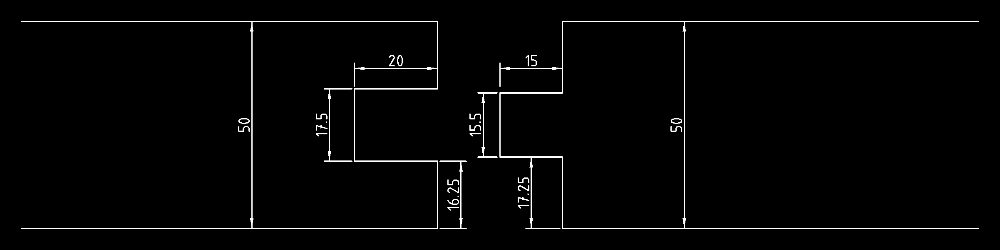

# 🔥 QuartzGate: Passive Structural, Mechanical & Sensory Firebreak Architecture

An open-source, 100% non-electric, non-mechanical, and biomimetic forestry framework designed to isolate and contain catastrophic wildfires using self-supporting fused silica (quartz) structures and low-maintenance conditional wildlife corridors.

---

## 📐 1. Structural Architecture & Scissor-Overlap Geometry

Unlike traditional vertical firewalls that require deep concrete foundations and risk collapse under intense wind loads, QuartzGate utilizes a self-supporting **A-frame triangular geometry** leaning at a **60-degree angle** relative to the ground. 

### 1.1 Tri-Feature Quartz Lamella & Hourglass (X-Key) Wind-Lock

To prevent wind suction (negative pressure) from pulling the glass panels outward without drilling holes, bolts, or exposing fasteners to extreme heat, each fused silica lamella integrates three cast-in geometric features secured by a low-profile symmetrical **hourglass (X-profile) wedge key**:

Top-Down Cross-Section (Single 1.0 m Quartz Lamella & Low-Profile Hourglass Key):
```text
  FIRE-FACING EXTERIOR (1000°C+ Thermal Zone 🔥 — 100% Smooth, Zero Fasteners)
  ═════════════════════════════════════════════════════════════════════════════
   ┌─────────────────────────────────────────────────────────────────────────┐
   │                                                                         │
  ═╡  MALE                                                           FEMALE  ╞═
  ═╡ TONGUE                 FUSED SILICA LAMELLA                   U-GROOVE  ╞═
   │  (Side)                         \‾‾‾‾‾/                        (Side)   │
   └──────────────────────────────────)   (──────────────────────────────────┘
                                     /     \   <-- 2. Low-Profile Hourglass Key
  SHELTERED INTERIOR                /_______\         (Preserves glass thickness)
  (A-Frame Cavity)
                            ════════════════════════ <-- 3. Matching Beam Groove
                                                           (Structural Horizontal Beam)
```
📐 **CAD Drawing:** [Download Tri-Feature Lamella & Hourglass Lock CAD (`quartzgate-lamella-lock-key.dxf`)](https://github.com)

## 📐 1.2 Internal Post-and-Beam Core

**The Scissor-Overlapped Ridge & One-Way Pressure Flaps:** Opposing 60-degree quartz planks cross each other at the apex in a scissor configuration to allow independent vertical settling on uneven terrain. The ridge gap is sealed by **upward-opening one-way flapper plates** (anchored with flexible basalt-fiber hinges to the upper horizontal composite beam). Internal rising heat and pressure push the flaps open to vent upward, whereas external firestorm wind gusts press the flaps tightly shut—completely blocking airborne embers from entering the A-frame cavity.


Side Cross-Section (A-Frame & Internal Support):
```text
          /\         <-- Scissor-overlapped quartz apex (no glass fasteners)
         /  \
        /    \
  ═════/══════\═════ <-- Horizontal cross-beam (connected to center post)
      /   ||   \
     /    ||    \    <-- Quartz lamellae locked via internal keys
    /     ||     \
═══/══════╩══════\══ [ GROUND SUBSTRATE ]
  [██]          [██] <-- 60° Ground Shoes
```
- **Height Calibration ($H_w$):** Dynamically calculated at 1.25 × the local canopy height to completely intercept direct flame contact and crown fire vectors.
- **Internal Post-and-Beam Skeleton (Zero Glass Penetration):** Vertical center posts and horizontal cross-beams carry all vertical and lateral loads internally. No holes, bolts, or external brackets touch the quartz glass.
- **Continuous Interlocking Mass & Wind Sheltering:** Adjacent 1.0 m quartz lamellae feature straight tongue-and-groove interlocks that bind them into a massive, continuous structural wall, reinforced by natural forest canopy wind-breaking.
- **Shallow, Low-Stress Internal Dovetail Groove:** The sheltered interior face of the glass features a shallow molded undercut dovetail groove (`\‾‾‾‾‾/`). Keeping the groove compact preserves over 85–90% of the panel's structural cross-section, preventing stress concentrations while keeping the fire-facing exterior 100% smooth.
- **Flush-Waist Hourglass (X-Key) Lock:** Once the glass panel rests directly against the inner horizontal beam, a loose, symmetrical hourglass-shaped wedge key is slid vertically into the matching dovetail grooves. Its narrowest waist aligns flush with the glass-to-beam contact plane, locking the panel tightly against both wind pressure and suction without bolts, tools, or thermal expansion stress.

---

## 🛠 2. Material-Optimized Mechanical Interlocking & Ground Assembly

The system completely eliminates external metallic tracks, bolts, or fasteners, which would warp, seize, or fail under extreme thermal expansion. Instead, all structural mechanics rely on material-saving gravity locks:




```text
Side Profile / Structural Assembly:
         / 
        /  <-- 1. Fused Silica Glass Lamellae (60-degree tilt)
       /  
  ════/═════════════ [ GROUND SUBSTRATE / TERRAIN ] ════════════
     /  
    [██]   <-- 2. Material-Optimized Short Metallic Ground Shoe (10–15 cm)
   /
```

*   **Vertical Sliding Slices & Terrain Adaptation:** The wall is constructed from vertically independent 1.0-meter-wide slices utilizing a straight male-female tongue and U-groove interlocking geometry. Because this interlocking joint is completely straight and runs parallel to the 60-degree tilt, **adjacent glass elements can slide vertically and independently relative to one another during installation. This allows standard-shaped rectangular lamellae to fluidly follow uneven terrain, ridges, and valleys without requiring custom-cut glass angles or causing structural binding.**
*   **Labyrinth Seal:** The internal cavity of the U-groove is pre-loaded with dry bentonite clay or volcanic basalt dust. This acts as a dry lubricant during assembly and terrain settling, and vitrifies (bakes into a solid ceramic seal) under extreme fire heat, making the joints 100% airtight.

### 2.1. 60° Angle-Guided Pilot Tool & Ground Shoe Installation

To ensure precise installation without heavy excavation or concrete pouring, the ground foundation relies on pre-aligned mechanical piercing:

```text
Installation Tool (Pilot Tool) Operating Principle:

      Sledgehammer / Rammer 🔨
            │
            ▼
        [ANVIL HEAD]
          //  
         //   <-- 1. Heavy-duty steel installation tool (50 cm chassis)
        //       
  ═════//════════════ [ TERRAIN SURFACE ] ═══════════════════════
      // 📐 60° angle verified by laser or guide-line
     //
    [V]       <-- 2. Wedge-shaped cutting tip (opens the trench)
```

*   **Laser & Guide-Line Alignment:** Long-distance construction lasers or mechanical guide-lines are deployed along the transit vector. The reference line height is calibrated so that when the trailing edge of the installation tool touches the line and the tip touches the ground, the tool is locked exactly at a **60-degree angle** relative to the horizon.
*   **Mechanical Pre-Piercing (50 cm Pilot Tool):** A heavy-duty, 50 cm hardened steel piercing tool matching the cross-section profile of the ground shoe is driven into the terrain using a sledgehammer, pneumatic hammer, or tractor-mounted hydraulic ram. 
*   **Resource Efficiency (70% Metal Mass Saved):** Once the 50 cm pilot trench is opened, the tool is extracted along its 60-degree path for immediate reuse. A short, lightweight, 10–15 cm permanent metallic ground shoe is then dropped into the finished slot to receive the glass element. This process saves 70% of structural metal mass per kilometer compared to continuous subterranean tracks.
*   **Self-Locking Uplift Wedge Anchor:** To prevent extreme firestorm wind suction (uplift) from pulling the 60-degree A-frame out of the soil, the ground shoe incorporates a two-piece **expanding wedge anchor**. Installed in a narrow profile into the 50 cm pilot trench, any upward tensile force draws the central conical wedge upward, forcing lateral anchor wings outward into undisturbed soil and beneath the root matrix—locking tighter the harder the wind pulls.
*   **Root Matrix Preservation:** The 50 cm wedge slices through small root networks rather than tearing them out like heavy excavators. This preserves the surrounding soil integrity and natural root binding.

---
## 🦌 3. Wide-Clearance 8m Overlapping Passages (Non-Mechanical Portals)

The system relies on a zero-mechanical-part design governed by an **8-meter parallel wall overlap**, eliminating direct line-of-sight, wind tunnels, and narrow bottlenecks while allowing heavy vehicles and wildlife to pass through safely. It also functions as an **aerodynamic ember trap** that neutralizes storm-driven firefronts.

```text
NORTH WALL (Fire / Wind Shield)
══════════════════════════════════════
                                        <-- Wide Vehicle & Wildlife Lane
                                             (Full clearance for heavy trucks)
                          ══════════════════════════════════════════
                          <--- 8m ---> overlap distance
                         SOUTH WALL (Outer Perimeter)
```

- **8-Meter Geometric Overlap:** The North and South wall lines overlap parallel to each other for a length of **8.0 meters**. This completely eliminates any direct line-of-sight or straight wind tunnel through the barrier.
- **Unrestricted Heavy-Vehicle & Wildlife Clearance:** Instead of narrow, claustrophobic bottlenecks, the perpendicular spacing between the overlapping North and South walls is wide enough to allow heavy forestry machinery, fire trucks, and large antlered wildlife to drive or migrate through effortlessly.
- **Aerodynamic Ember Trap:** When a storm-driven firefront approaches from the south, airborne embers and radiant heat collide directly against the overlapping 8-meter section of the North wall. Forced to make two sharp 90-degree turns through a wide pressure-drop zone, embers lose momentum and drop harmlessly to the ground before reaching the safe zone.

---

## ⛺ 4. Meteorological Funnel Sectoring & Risk Minimization

The forest region is partitioned by radial, star-patterned QuartzGate walls extending outward from a central circular command and monitor hub (equipped with automated water cannons). The sectors are mapped according to dominant regional wind patterns (e.g., south/southwesterly winds):

Top-Down Macro Layout (Radial Funnel Sectoring & Central Command Hub):
.png)

*   **The Funnel Effect:** Sectors tapering inward from the outer perimeter force the advancing firefront into a narrowing funnel. This compresses the fire's surface area to its absolute minimum, allowing the central water cannons to concentrate their entire payload directly into the choke point rather than sweeping across a wide arc.
*   **Wind-Aligned Campsite Sectoring:** Public camping and recreation zones are strictly restricted to downwind (northern/northeastern) sectors relative to the main forest body. If human negligence triggers a fire, the prevailing winds carry the embers and smoke directly *outward* toward the empty outer perimeter, completely neutralizing the risk of destroying the core reservation or the automated command hub.

---

## 🧱 5. Material Specifications & Opaque White Fused Silica Architecture

The system utilizes **Opaque Micro-Bubbled White Fused Silica (White Quartz Glass)** as its primary exterior structural medium to prevent critical failure modes:

- **Superior Infrared Reflection:** Millions of microscopic trapped gas bubbles scatter and reflect over 90% of wildfire infrared radiation outward while keeping the interior cool and enabling production from local silica sand without vacuum purification.
- **Thermal Shock Immunity:** Possessing a near-zero coefficient of thermal expansion ($0.5 \times 10^{-6} \text{ K}^{-1}$), it withstands extreme temperature differentials (such as a 1000°C firefront against 20°C ambient air) without shattering.
- **High-Temperature Rigidity:** With a continuous operating threshold of **1200°C** and a softening point above **1600°C**, the material retains its geometric rigidity during direct crown fire contact where structural steel would buckle.
- **Chemical Immortality:** Being chemically inert, it avoids the atmospheric corrosion, biological decay, and UV degradation common to metals, timber, and polymers.

## 🏭 6. Modular Off-Site Prefabrication & Rapid Field Logistics

Rather than complex on-site glass smelting, QuartzGate relies on standardized **1.0-meter-wide factory-cast opaque white fused silica panels** and pultruded **Basalt Fiber Reinforced Polymer (BFRP)** profiles:
* **Zero-Custom-Cut Logistics:** Because the straight vertical tongue-and-groove joints slide independently along the 60-degree tilt, every lamella is an identical rectangular module that stacks flat on standard forestry trailers.
* **Rapid Mechanical Assembly:** Lightweight 10–15 cm expanding ground shoes and dry hourglass X-keys allow field crews to erect permanent firebreaks without concrete curing times, welding, or heavy crane infrastructure.

## 👁 7. Sensory Integration & Environmental Base Seal

To harmonize the structure with the local ecosystem, the design implements a specialized nature-protective barrier:

- **Inherent Wildlife & Avian Visibility:** Unlike transparent glass, opaque micro-bubbled white quartz panels present a bright, milky-white visual surface. This naturally prevents bird collisions without requiring separate UV-reflective coatings and gently guides wildlife toward the wide 8-meter overlapping migration corridors.
- **Environmental Base Seal:** Volcanic basalt fiber blankets or clay matrices anchor the quartz lamellae to the terrain and seal ground-level gaps against creeping embers without disturbing soil microfauna.

---

## 8. Automated Active Suppression & Hydrological Infrastructure
### 8.1. Predictive Pre-Wetting Choke Logic
The central circular command hub utilizes a predictive Tactical Pre-Wetting Framework rather than reactive spraying, channeling and saturating target zones ahead of advancing firefronts to prevent ignition and starve the fire of energy.

```text
Suppression Strategy (Top-Down Vector):

           [ ADVANCING FIREFRONT 🔥 ]
                     │
                     ▼   (Funnels inward)
             \               /
              \  SECTOR A   /   <-- Tapering sector compresses fire surface area.
               \           /
    ════════════\=========/════════════ [ QUARTZGATE WALLS ]
                 \       /
                  \     /       <-- TARGET ZONE: Heavily saturated *before* fire arrival.
                   \   /            Prevents ignition and seals short transit vectors.
                    \ /
                     █          <-- Central Command Hub (Automated Water Cannons 💦)
```

*   **Dynamic Sector Isolation:** Automated multi-spectral sensors (Infrared/Thermal) detect which radial funnel sector the fire has breached. The central hub immediately isolates this specific sector and locks out the shortest transit paths leading to adjacent, unburned zones.
*   **Predictive Pre-Wetting:** The high-capacity automated water cannons concentrate their entire payload exclusively onto the unburned terrain and canopy *directly ahead* of the advancing firefront within that sector. 
*   **Fuel Starvation Strategy:** Saturating the vegetation beforehand spikes the moisture content of the forest fuel matrix to 100%. When the thermal wave hits the pre-wetted boundary, the fire's kinetic energy is completely absorbed by water vaporization, instantly stalling the front against the QuartzGate wall and starving it of the energy required to jump or breach the sector lines.

---

### 8.2. Passive Hydrological Infrastructure & Gravity-Fed Supply Lines

The water delivery system ensures high survivability through topographic placement and protected subterranean routing:
A-Frame Utility Corridor: Mainlines run beneath the hollow A-frame structure, shielded by the quartz wall from heat, falling timber, and freezing.
Topographic Gravity Feed: Elevated reservoirs utilize natural geography to generate hydrostatic pressure without relying on vulnerable electrical pumps or generators.

```text
Hydrological Flow (Cross-Section Profile):

  [ HIGHER TERRAIN 🏔️ ]
  ┌─────────────────┐
  │ UPPER RESERVOIR │ <-- 1. Elevated water storage (High potential energy)
  └────────┬────────┘
           │
           ▼ (Hydrostatic Pressure / Gravity Feed 💧)
           │
  ═════════Stream════════════════════════════════════════════════ [ TERRAIN ] ═════════
           │
           └─► [ SUBTERRENEAN PIPE ] <-- 2. Buried safely below frost line
                 (Protected directly under the hollow A-frame canopy)
                                                      │
                                                      ▼
                                             ┌─────────────────┐
                                             │   CENTRAL HUB   │ <-- 3. High-velocity
                                             │  WATER CANNONS  │      suppression without
                                             └─────────────────┘      electrical pumps.
```

*   **A-Frame Utility Corridor:** Water mainlines are routed directly underneath the hollow triangular interior of the A-frame wall structure, buried shallowly below the frost line. This design leverages the quartz wall as a thermal and structural shield, protecting the piping network from extreme wildfire heat, falling timber, and freezing winter conditions without requiring disruptive excavation through open forest root matrices.
*   **Topographic Gravity Feed:** Whenever local geography permits, main water storage reservoirs are constructed in high-altitude sectors relative to the central command hub. This height differential utilizes natural topography to generate immense hydrostatic pressure.
*   **Fail-Safe Non-Electric Delivery:** By using gravity as the primary propellant, the system can launch high-velocity pre-wetting vectors without relying on mechanical generators, electrical grids, or booster pumps, which are highly prone to failure during a wildfire crisis. If space or elevation is restricted around the center circle, modular subterranean tanks are integrated directly inside the hub's foundation matrix.
---
## 📡 9. Ultra-Low-Power Surveillance & Color-Coded Fire Matrix

To operate independently of vulnerable power grids and automated AI logic, the command hub uses a low-voltage, human-verified framework:

```text
Command Tower & Visual Signaling Matrix (Side Profile):

                   [ HIGH-MOUNTED CAMERAS 📷 ]
                     (Solar + Battery Powered)
                                │
                                ▼
                       ┌─────────────────┐
                       │  WATCH TOWER    │ <-- 1. 2-Person Human Control Core
                       │  (Verifiers)    │      (Zero algorithmic false positives)
                       └────────┬────────┘
                                │
                                ▼ (Manual or low-voltage deployment)
                       ┌─────────────────┐
                       │  COLOR MATRIX   │ <-- 2. High-visibility chemical cartridge
                       │   CARTRIDGES    │      (Projects bright color aerosol marker)
                       └────────┬────────┘
                                │
                                ▼
         [ ORANGE / RED SMOKE 💨 ] ===> Identifies absolute fire front vector, 
                                        wind shear, and approach velocity.
```

*   **Off-Grid Solar Autonomy:** The core electronics are restricted to high-mounted, low-draw surveillance cameras positioned on a central observation tower to survey the surrounding canopy. This entire sensor array is localized and powered by a dedicated solar panel matrix backed by a ruggedized battery bank, keeping the gate 100% independent of external infrastructure.
*   **2-Person Human Verification Core:** Instead of fragile software sensors that can fail due to thermal bloom or thick soot interference, two human operators occupy the protected central hub. They analyze the camera feeds and manual cross-sightings, acting as the ultimate fail-safe deployment trigger before activating the water supply valves.
*   **Chemical Color Matrix Signaling:** The tower is equipped with directional, mechanical or low-voltage chemical smoke cartridges (Color Smoke Cartridges). Upon fire confirmation, the operators deploy a specific color marker toward the threat vector:
    *   **Vector Definition:** The bright, chemical-colored aerosol cuts through dark charcoal forest smoke, instantly mapping the exact point of entry and boundaries of the threatened funnel sector.
    *   **Aviation & Ground Coordination:** The rising colored plume acts as a passive, non-electronic beacon for distant firefighting aircraft and ground crews, revealing wind shear, air velocity, and fire progression speed in real-time without relying on radio communication or GPS grids.

---

## 📊 10. Economic Assessment: Capital Investment vs. The Cost of Inaction

To evaluate the true return on investment (ROI) of the QuartzGate framework, the initial production cost of fused silica must be directly cross-referenced against the multi-decade lifecycle maintenance costs and the catastrophic reality of an unprotected ecosystem breakout.

### 10.1. Financial Comparison (10 km / 25 m Reference Line)

| Financial Phase | Traditional Reactive Model (No Wall) | QuartzGate Passive Architecture |
| :--- | :--- | :--- |
| **Initial CAPEX** | €0 | ~€15,800,000 (Prefabricated white silica & BFRP frame) |
| **50-Year OPEX** | Variable / High (Fuel management, clearing, machinery) | Low / Minimal (Periodic inspections) |
| **Active Suppression** | €15M – €40M per crisis (Water-bombers, aviation, personnel) | Near Zero (Automated gravity-fed targeted pre-wetting) |
| **Property & Asset Losses** | €30M – €70M (Destruction of timber, structures, utilities) | Minimized (Firefront structurally contained) |
| **Post-Fire Restoration** | €50M – €150M (Erosion control, hazard clearing, replanting) | €0 (Soil and root matrix preserved) |
| **Total per Crisis** | 🟥 €100M – €300M (Catastrophic drain + decades of recovery) | 🟩 ~€15,800,000 (Fixed permanent structure, ready for repeat events) |

### 10.2. Fused Silica Investment Rationalization

The economic illusion of standard infrastructure (such as steel or concrete) lies in cheap procurement. However, when exposed to 1000°C extreme wildfire vectors, steel buckles and concrete suffers structural spalling (explosive fracturing due to interior moisture vaporization), resulting in a **100% loss of investment capital**. 

QuartzGate concentrates almost 100% of the project budget directly into the high-temperature resilience of **Type I Fused Silica**:
1. **The Single-Purchase Imperative:** Fused silica pays for itself during the very first wildfire engagement by transforming a multi-million-euro regional emergency into a passively contained, low-velocity localized event.
2. **True Life-Cycle Viability:** By shifting public funds away from repeating, retroactive disaster-relief expenses (aircraft hours, post-fire reconstruction) into a permanent, non-degrading physical asset, governments and private forestry matrices achieve a self-sustaining security profile that outlives traditional budgetary cycles.

---

## 🧪 11. Ecological Chemistry: Eco-Safe Saline Retardant Augmentation

To maximize the efficiency of the gravity-fed suppression system and prevent rapid water evaporation during extreme high-temperature crown fires, the framework integrates localized chemical augmentation. Traditional rock salt or road salt (sodium chloride) is strictly forbidden due to permanent groundwater contamination and soil erosion. Instead, the grid utilizes highly specific, eco-safe flame-retardant salt solutions.

### 11.1. Recommended Chemical Matrix & Mechanics

The water storage reservoirs are pre-loaded or injected with **Ammonium Sulfate** or **Calcium Magnesium Acetate (CMA)** blends to form a specialized suppression brine:

```text
Saline Suppression Dynamics (Thermal Interception):

     [ WATER CANNON 💦 ] ──► (Discharges Saline Brine Spray)
                                      │
                                      ▼
                        [ TARGET CANOPY & FUEL MATRIX 🌲 ]
                                      │
        ┌─────────────────────────────┴─────────────────────────────┐
        ▼ (Phase 1: Water Evaporation)                              ▼ (Phase 2: Fused Salt Shield)
  Moisture spikes to 100%.                            Water evaporates, leaving behind a thick,
  Thermal energy is absorbed by vaporization.         factory-fused crystalline mineral layer on fuel.
                                                                    │
                                                                    ▼
                                                      [ CHEMICAL RETARDANT BLOCK 🔥 ]
                                                      Crystals undergo endothermic decomposition, 
                                                      forming a non-combustible ceramic char-layer.
                                                      Oxygen is blocked; flame front is starved.
```

*   **Evaporative Crystal Shield:** When the saline brine is sprayed onto the unburned canopy ahead of the fire front, the water component provides immediate thermal cooling. As the extreme heat of the approaching fire evaporates the water, it leaves behind a thick, uniform coating of non-combustible mineral crystals bound to the needles, leaves, and timber.
*   **Endothermic Gas Release & Char-Layering:** Upon direct contact with flames, these specific alternative salts undergo a chemical decomposition process. Instead of feeding the fire, they release non-flammable inert vapors that dilute ambient oxygen at the fuel surface. Concurrently, they catalyze the formation of a carbonaceous, ceramic-like char-layer on the wood, preventing the underlying timber from reaching its ignition temperature even under sustained thermal radiation.

### 11.2. Post-Crisis Environmental Regeneration

Unlike standard commercial retardants that leave toxic residues, the selected chemical matrix acts as a dual-purpose ecological safeguard:

*   **Nutrient Conversion:** Once the fire crisis is averted and seasonal rains wash the mineral crystals off the canopy into the forest floor, Ammonium Sulfate breaks down into natural nitrogen and sulfur matrices. 
*   **Soil Recovery Catalyst:** Rather than poisoning the ecosystem, the residual retardant transforms into a high-grade agricultural fertilizer. This actively stimulates the surrounding root networks and accelerates the bio-regeneration of the local flora, ensuring the forest recovers at an accelerated rate post-incident.

## 🐍 12. Parametric Python Tools (BOM Calculator & CAD Generator)

The repository includes two standalone, zero-dependency Python scripts for scaling the architecture to any forest perimeter:

- **`quartzgate_calculator.py`:** Computes fused silica lamellae count, internal basalt fiber composite post-and-beam tonnage, hourglass X-keys, ground shoes, and CAPEX vs. wildfire loss benchmarks (`python quartzgate_calculator.py --km 10 --canopy 20 --thickness 50`).
- **`quartzgate_dxf_generator.py`:** Generates a 1:1 millimeter DXF cross-section file of the tri-feature lamella and hourglass lock (`python quartzgate_dxf_generator.py --width 1000 --thickness 50`).

## ⏳ 13. Golden Hour Time-Buying Architecture: Windward Thermal Reservoir & Sector-Indexed Ballistic Pre-Wetting

In remote forestry regions, ground firefighting units and aerial water-bombers frequently require **30 to 90 minutes** to reach an active ignition site. To bridge this critical response gap ("Golden Hour") without relying on vulnerable electrical pumps, pressurized pipelines, or automated software, QuartzGate integrates a two-stage passive/mechanical time-buying layer prioritized for **high-wind corridors**. *(Note: In low-wind sectors, the 60-degree fused silica lamella walls alone provide sufficient containment).*

### 13.1. Windward Artificial Reservoir & Solar-Heated Evaporation Stones
Positioned upwind of fire-prone forest sectors and funnel choke points, an artificial water basin serves both as a microclimate humidifier and a strategic firefighting water source:

```text
[ PREVAILING WIND 💨 ] ──► Passes over Sun-Heated Dark Basalt Stones & Shallow Basin
                                 │
                                 ▼ (Phase Change & Advection)
                       [ HUMIDIFIED AIR PLUME 💧 ] ──► Raises fuel moisture in downwind forest
                                                       & provides rapid aerial/ground water refill
```

* **Wind-Driven Deployment Priority:** Deployed selectively in high-wind corridors where convective drying and long-range ember spotting are highest. Strong winds actively accelerate evaporation off the wet stone surfaces and transport humidified air directly into the vulnerable canopy ahead of potential fire fronts.
* **Sensible Heat Storage & Phase Change:** Dark, low-porosity igneous stones (e.g., basalt or diabase) absorb solar radiation and transfer heat to a shallow water film, driving continuous vaporization (2,260 kJ/kg latent heat). This elevates ambient relative humidity downwind, keeping pine needles and understory moss above critical ignition dryness thresholds.
* **Dual-Purpose Firefighting Supply:** While the shallow stone-lined perimeter maximizes evaporation, the deeper central reservoir acts as an immediate, high-volume refill point for firefighting helicopters, ground tankers, and QuartzGate’s gravity-fed mainlines.

### 13.2. Non-Electric Sector-Indexed Ballistic Pre-Wetting (Biodegradable Capsule Swarm)
To saturate the funnel choke zone ahead of an approaching fire front without electric pumps or wind-dispersed water mist, the central command hub utilizes a **counterweight mechanical thrower (trebuchet principle)** calibrated with physical sector locks:

```text
[ COMMAND HUB LAUNCHER ] (Counterweight Gravity Drive — Zero Electricity)
   │  ├── Azimuth Lock:  [ Sector A ]  [ Sector B ]  [ Sector C ]
   │  └── Range Pin:     [ Zone 1: Near ] [ Zone 2: Mid ] [ Zone 3: Far ]
   ▼
(Launches 30–50 Biodegradable Alginate/Cellulose Capsules per cycle)
   │
   ▼ (Natural Aerodynamic Dispersion)
[ CANOPY PENETRATION ] ──► Capsules pass through tree crowns intact, bursting on
                           ground fuel to deliver eco-safe saline retardant (CMA/Ammonium Sulfate).
```

* **Zero-Electricity Mechanical Indexing (Poka-Yoke Calibration):** During installation, test trajectories are physically engraved onto the launcher’s azimuth turntable (**Sectors A, B, C**) and counterweight/release-pin stops (**Range Zones 1–3**). In an emergency, operators simply drop mechanical locking pins into the designated sector and range holes—achieving repeatable ballistic accuracy in seconds with zero electronics, batteries, or sensors.
* **Biodegradable Capsule Swarm (Dispersion & Canopy Penetration):** Instead of a single heavy projectile or a fine water spray that evaporates in hot updrafts, each launch releases a cluster of **30–50 small (100–200 g) biodegradable seaweed-alginate or cellulose capsules** filled with eco-safe **Ammonium Sulfate or CMA brine**. Aerodynamic differences naturally disperse the cluster into an even saturation pattern, while the capsule mass punches through upper tree branches to burst directly onto the forest floor where surface fires propagate.
* **Tailwind Ballistic Advantage & Co-Location:** Because the artificial reservoir is already positioned upwind of the high-risk forest sector, co-locating the mechanical launcher along the reservoir berm allows launches to fire **downwind**. The prevailing tailwind adds aerodynamic carry and range to the biodegradable capsule swarm while allowing direct gravity-fed capsule filling right from the basin.
* **Buying 30–90 Minutes for First Responders:** The saline brine spikes surface fuel moisture and leaves behind a non-combustible crystalline mineral layer that resists rapid solar evaporation. This stalls or drastically slows the advancing fire front against the QuartzGate wall, preserving the perimeter until municipal fire crews and aircraft arrive on scene.

## 🏭 14. Off-Grid In-Situ Manufacturing: Hybrid Solar-Thermite C/C & Fused Silica Foundry (v2.0)

To enable decentralized, zero-grid production of **Opaque Micro-Bubbled White Fused Silica** lamellae and reusable **Carbon-Carbon (C/C)** tooling directly near high-risk forestry perimeters, QuartzGate integrates a two-reactor closed-loop manufacturing ecosystem:

```text
Closed-Loop Manufacturing Ecosystem:

   [ CONCENTRATED SUNLIGHT ☀️ ]
                 │
                 ▼
   ┌───────────────────────────┐
   │  DUAL-QUARTZ SOLAR        │  ──► Pyrolysis & Densification (900–1500 °C)
   │  FURNACE (Optical Oven)   │  ──► Produces: C/C Rollers, Molds & Quartz Tubes
   └─────────────┬─────────────┘
                 │ (Supplies non-wetting C/C tooling)
                 ▼
   ┌───────────────────────────┐
   │  HORIZONTAL THERMITE      │  ──► Exothermic Fusion (>2000 °C, 24/7 All-Weather)
   │  FOUNDRY (Casting Bed)    │  ──► Produces: Opaque Quartz Lamellae & Modules
   └───────────────────────────┘
```

### 14.1. Horizontal Thermite-Roller Foundry (24/7 All-Weather Casting)
Eliminating tall vertical melting towers, delicate lenses, and hazardous molten glass pouring, the v2.0 foundry lays the Carbon-Carbon (C/C) mold flat on a horizontal bed inside a standard mobile shipping container or forestry trailer:

```text
Side Cross-Section (Horizontal C/C Mold & Two-Stage Roller):

   [ C/C ROLLER 1: Compaction & Slag Skimming ]     [ C/C ROLLER 2: Smooth Finish & Cooling ]
                   (  O  )   ---> Travel Vector --->         (  O  )
   ═══════════════════════════════════════════════════════════════════════════════════════════
   │ ░░░░░░░░░░░░░░░ Molten / Solidifying Opaque Fused Silica (100% Smooth Top) ░░░░░░░░░░░ │
   └───────────────────────────────\_______/────────────────────────────────────────────────┘
   ═══════════════════════════════════════════════════════════════════════════════════════════
   [ Static C/C Base Mold (Machined Dovetail Groove & Tongue-and-Groove Side Profiles) ]
```

* **Static Bottom-Groove Mold:** Raw silica sand (SiO₂) and calibrated thermite strips (iron oxide + aluminum powder) are loaded cold into a flat C/C base mold. All male/female tongue-and-groove edges and the shallow undercut dovetail groove (`\_______/`) for the hourglass X-key are machined directly into the static C/C base plate and side rails.
* **Inherent Opaque Micro-Bubble Structure:** Rapid, non-vacuum thermite ignition releases >2000 °C inside the silica matrix and naturally traps millions of microscopic gas bubbles—creating the exact **Opaque White Fused Silica** microstructure needed to reflect >90% of wildfire infrared radiation, while molten iron/alumina slag separates cleanly to the top surface and perimeter traps.
* **Two-Stage C/C Roller Compaction & Quenching:** Under an inert gas (nitrogen/argon) hood, **Roller 1** compacts the semi-molten silica into the base grooves and skims floating slag into end trays, while cooler **Roller 2** irons the fire-facing top surface glass-smooth and draws heat out at a controlled rate without sticking.
* **Frictionless Horizontal Extraction:** A hinged or wedge-locked C/C end-gate swings open at the discharge end. Because fused silica exhibits zero wetting or adhesion to graphitized C/C (whose mechanical strength increases up to 2200 °C), the finished 1.0 m lamella slides out flat onto an annealing rack with minimal push force and zero bending stress.

### 14.2. Optical Dual-Quartz Solar Furnace & Circular Waste Upcycling
To manufacture and densify the non-wetting C/C rollers and base molds without electrical resistance heaters, the system uses a concentric **Dual-Quartz Solar Furnace** that double-functions as an off-grid pyrolysis refinery:

```text
Dual-Quartz Gas Curtain & Optical Heat Trap (Cross-Section):

   [ Outer Clear Quartz Wall (Remains 100% clean & cooler) ]
   ═══════╤═════════════════════════════════════════════╤═══════
          │  --> Preheated Inert Gas (Ar / N₂) Flow --> │
   ═══════╧═══════╗    (Alternating Vent)     ╔═════════╧═══════
   [ Inner Hot Quartz Wall (>400 °C, prevents tar condensation) ]
                  ▼                           ▼
            [ C/C Workpiece / Roller (900–1100 °C) ]
                  │
                  └──► [ Pyrolysis Vapors & Volatiles Exhaust ]
```

* **Self-Cleaning Preheated Gas Curtain:** Inert gas (argon or nitrogen) preheats between two concentric fused-quartz walls before venting inward through alternating ports—keeping the hot inner wall (>400 °C) free of soot and phenolic tars so the outer optical window remains 100% transparent to concentrated sunlight.
* **Zero-Acid E-Waste & Plastic Upcycling:** Operating at 450–900 °C in an oxygen-free chamber, the solar furnace cleanly pyrolyzes non-recyclable plastics and Printed Circuit Boards (PCBs)—recovering unoxidized metals ($Cu, Au, Ag, Sn$), liquid pyrolysis oil, syngas ($H_2, CH_4$), and high-purity **carbon black** (fed directly back into C/C composite tooling and thermite mixtures), while an alkaline calcium oxide/sodium carbonate scrubber neutralizes corrosive $HCl$ and $HBr$ gases into harmless mineral salts.

📄 License

This project is licensed under the MIT License – Copyright (c) 2026 masakertsa.
