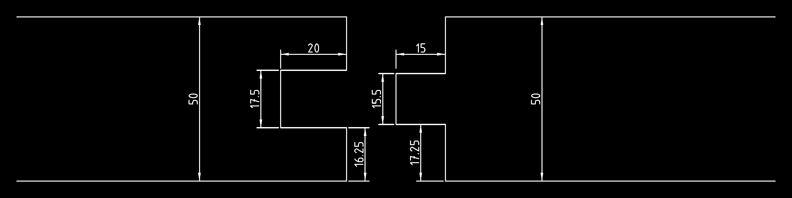

# 🔥 QuartzGate: Passive Structural, Mechanical & Sensory Firebreak Architecture

An open-source, 100% non-electric, non-mechanical, and biomimetic forestry framework designed to isolate and contain catastrophic wildfires using self-supporting fused silica (quartz) structures and zero-maintenance conditional wildlife corridors.

---

## 📐 1. Structural Architecture & Scissor-Overlap Geometry

Unlike traditional vertical firewalls that require deep concrete foundations and risk collapse under intense wind loads, QuartzGate utilizes a self-supporting **A-frame triangular geometry** leaning at a **60-degree angle** relative to the ground. 

### 1.1 Tri-Feature Quartz Lamella & Hourglass (X-Key) Wind-Lock

To prevent wind suction (negative pressure) from pulling the glass panels outward without drilling holes, bolts, or exposing fasteners to extreme heat, each fused silica lamella integrates three cast-in geometric features secured by a low-profile symmetrical **hourglass (X-profile) wedge key**:

Top-Down Cross-Section (Single 1.0 m Quartz Lamella & Low-Profile Hourglass Key):
```text
  FIRE-FACING EXTERIOR (1000°C+ Thermal Zone 🔥 — 100% Smooth, Zero Fasteners)
  ═════════════════════════════════════════════════════════════════════════════
   ┌─────────────────────────────────────────────────────────────────────────┐
   │                                                                         │
  ═╡  MALE                                                           FEMALE  ╞═
  ═╡ TONGUE                 FUSED SILICA LAMELLA                   U-GROOVE  ╞═
   │  (Side)                         \‾‾‾‾‾/                        (Side)   │
   └──────────────────────────────────)   (──────────────────────────────────┘
                                     /     \   <-- 2. Low-Profile Hourglass Key
  SHELTERED INTERIOR                /_______\         (Preserves glass thickness)
  (A-Frame Cavity)
                            ════════════════════════ <-- 3. Matching Beam Groove
                                                           (Structural Horizontal Beam)
```
📐 **CAD Drawing:** [Download Tri-Feature Lamella & Hourglass Lock CAD (`quartzgate-lamella-lock-key.dxf`)](https://github.com)

## 📐 1.2 Internal Post-and-Beam Core

QuartzGate utilizes a self-supporting **A-frame triangular geometry** at a **60-degree angle**, reinforced by a sheltered internal post-and-beam skeleton.

Side Cross-Section (A-Frame & Internal Support):
```text
          /\         <-- Scissor-overlapped quartz apex (no glass fasteners)
         /  \
        /    \
  ═════/══════\═════ <-- Horizontal cross-beam (connected to center post)
      /   ||   \
     /    ||    \    <-- Quartz lamellae locked via internal keys
    /     ||     \
═══/══════╩══════\══ [ GROUND SUBSTRATE ]
  [██]          [██] <-- 60° Ground Shoes
```
- **Height Calibration ($H_w$):** Dynamically calculated at 1.25 × the local canopy height to completely intercept direct flame contact and crown fire vectors.
- **Internal Post-and-Beam Skeleton (Zero Glass Penetration):** Vertical center posts and horizontal cross-beams carry all vertical and lateral loads internally. No holes, bolts, or external brackets touch the quartz glass.
- **Continuous Interlocking Mass & Wind Sheltering:** Adjacent 1.0 m quartz lamellae feature straight tongue-and-groove interlocks that bind them into a massive, continuous structural wall, reinforced by natural forest canopy wind-breaking.
- **Shallow, Low-Stress Internal Dovetail Groove:** The sheltered interior face of the glass features a shallow molded undercut dovetail groove (`\‾‾‾‾‾/`). Keeping the groove compact preserves over 85–90% of the panel's structural cross-section, preventing stress concentrations while keeping the fire-facing exterior 100% smooth.
- **Flush-Waist Hourglass (X-Key) Lock:** Once the glass panel rests directly against the inner horizontal beam, a loose, symmetrical hourglass-shaped wedge key is slid vertically into the matching dovetail grooves. Its narrowest waist aligns flush with the glass-to-beam contact plane, locking the panel tightly against both wind pressure and suction without bolts, tools, or thermal expansion stress.
- **The Scissor-Overlapped Ridge & Chimney Effect:** Opposing 60-degree quartz planks cross each other at the apex in a scissor configuration to allow independent vertical settling on uneven terrain, while the hollow triangular interior acts as a pressure-venting chimney that cools and extinguishes embers.

---

## 🛠 2. Material-Optimized Mechanical Interlocking & Ground Assembly

The system completely eliminates external metallic tracks, bolts, or fasteners, which would warp, seize, or fail under extreme thermal expansion. Instead, all structural mechanics rely on material-saving gravity locks:




```text
Side Profile / Structural Assembly:
         / 
        /  <-- 1. Fused Silica Glass Lamellae (60-degree tilt)
       /  
  ════/═════════════ [ GROUND SUBSTRATE / TERRAIN ] ════════════
     /  
    [██]   <-- 2. Material-Optimized Short Metallic Ground Shoe (10–15 cm)
   /
```

*   **Vertical Sliding Slices & Terrain Adaptation:** The wall is constructed from vertically independent 1.0-meter-wide slices utilizing a straight male-female tongue and U-groove interlocking geometry. Because this interlocking joint is completely straight and runs parallel to the 60-degree tilt, **adjacent glass elements can slide vertically and independently relative to one another during installation. This allows standard-shaped rectangular lamellae to fluidly follow uneven terrain, ridges, and valleys without requiring custom-cut glass angles or causing structural binding.**
*   **Labyrinth Seal:** The internal cavity of the U-groove is pre-loaded with dry bentonite clay or volcanic basalt dust. This acts as a dry lubricant during assembly and terrain settling, and vitrifies (bakes into a solid ceramic seal) under extreme fire heat, making the joints 100% airtight.

### 2.1. 60° Angle-Guided Pilot Tool & Ground Shoe Installation

To ensure precise installation without heavy excavation or concrete pouring, the ground foundation relies on pre-aligned mechanical piercing:

```text
Installation Tool (Pilot Tool) Operating Principle:

      Sledgehammer / Rammer 🔨
            │
            ▼
        [ANVIL HEAD]
          //  
         //   <-- 1. Heavy-duty steel installation tool (50 cm chassis)
        //       
  ═════//════════════ [ TERRAIN SURFACE ] ═══════════════════════
      // 📐 60° angle verified by laser or guide-line
     //
    [V]       <-- 2. Wedge-shaped cutting tip (opens the trench)
```

*   **Laser & Guide-Line Alignment:** Long-distance construction lasers or mechanical guide-lines are deployed along the transit vector. The reference line height is calibrated so that when the trailing edge of the installation tool touches the line and the tip touches the ground, the tool is locked exactly at a **60-degree angle** relative to the horizon.
*   **Mechanical Pre-Piercing (50 cm Pilot Tool):** A heavy-duty, 50 cm hardened steel piercing tool matching the cross-section profile of the ground shoe is driven into the terrain using a sledgehammer, pneumatic hammer, or tractor-mounted hydraulic ram. 
*   **Resource Efficiency (70% Metal Mass Saved):** Once the 50 cm pilot trench is opened, the tool is extracted along its 60-degree path for immediate reuse. A short, lightweight, 10–15 cm permanent metallic ground shoe is then dropped into the finished slot to receive the glass element. This process saves 70% of structural metal mass per kilometer compared to continuous subterranean tracks.
*   **Root Matrix Preservation:** The 50 cm wedge slices through small root networks rather than tearing them out like heavy excavators. This preserves the surrounding soil integrity and natural root binding.

---
## 🦌 3. Wide-Clearance 8m Overlapping Passages (Non-Mechanical Portals)

The system relies on a zero-mechanical-part design governed by an **8-meter parallel wall overlap**, eliminating direct line-of-sight, wind tunnels, and narrow bottlenecks while allowing heavy vehicles and wildlife to pass through safely. It also functions as an **aerodynamic ember trap** that neutralizes storm-driven firefronts.

```text
NORTH WALL (Fire / Wind Shield)
══════════════════════════════════════
                                        <-- Wide Vehicle & Wildlife Lane
                                             (Full clearance for heavy trucks)
                          ══════════════════════════════════════════
                          <--- 8m ---> overlap distance
                         SOUTH WALL (Outer Perimeter)
```

- **8-Meter Geometric Overlap:** The North and South wall lines overlap parallel to each other for a length of **8.0 meters**. This completely eliminates any direct line-of-sight or straight wind tunnel through the barrier.
- **Unrestricted Heavy-Vehicle & Wildlife Clearance:** Instead of narrow, claustrophobic bottlenecks, the perpendicular spacing between the overlapping North and South walls is wide enough to allow heavy forestry machinery, fire trucks, and large antlered wildlife to drive or migrate through effortlessly.
- **Aerodynamic Ember Trap:** When a storm-driven firefront approaches from the south, airborne embers and radiant heat collide directly against the overlapping 8-meter section of the North wall. Forced to make two sharp 90-degree turns through a wide pressure-drop zone, embers lose momentum and drop harmlessly to the ground before reaching the safe zone.

---

## ⛺ 4. Meteorological Funnel Sectoring & Risk Minimization

The forest region is partitioned by radial, star-patterned QuartzGate walls extending outward from a central circular command and monitor hub (equipped with automated water cannons). The sectors are mapped according to dominant regional wind patterns (e.g., south/southwesterly winds):

Top-Down Macro Layout (Radial Funnel Sectoring & Central Command Hub):
.png)

*   **The Funnel Effect:** Sectors tapering inward from the outer perimeter force the advancing firefront into a narrowing funnel. This compresses the fire's surface area to its absolute minimum, allowing the central water cannons to concentrate their entire payload directly into the choke point rather than sweeping across a wide arc.
*   **Wind-Aligned Campsite Sectoring:** Public camping and recreation zones are strictly restricted to downwind (northern/northeastern) sectors relative to the main forest body. If human negligence triggers a fire, the prevailing winds carry the embers and smoke directly *outward* toward the empty outer perimeter, completely neutralizing the risk of destroying the core reservation or the automated command hub.

---

## 🧱 5. Material Specifications & Irreplaceable Fused Silica Architecture

The system strictly utilizes **Fused Silica / Quartz Glass** as its primary structural medium. Substituting this material with standard glass, borosilicate variants, or concrete composites introduces catastrophic failure points due to the following non-negotiable physical constraints:

*   **Absolute Thermal Shock Immunity:** Fused silica exhibits a near-zero coefficient of thermal expansion ($0.5 \times 10^{-6} \text{ K}^{-1}$). While standard glass shatters instantly under asymmetrical thermal loads (1000°C firefront on the exterior vs. 20°C ambient air on the interior), fused silica can be heated to a red glow and quenched in ice water without structural fracturing.
*   **High-Temperature Mechanical Rigidity:** The continuous operating threshold of quartz glass reaches **1200°C**, with a softening point exceeding **1600°C**. Unlike structural steel, which loses over 50% of its load-bearing capacity at 500–600°C and buckles under heavy wind, the QuartzGate A-frame maintains complete geometric rigidity during direct crown fire contact.
*   **Chemical and Biological Immortality (Zero Maintenance):** Fused silica is chemically inert. It does not suffer from atmospheric corrosion (rust) like metals, biological decay like timber, or UV degradation like polymer-matrix composites. This guarantees a multi-decade operational lifespan in acidic forest soils with zero structural maintenance.

---

## 👁 6. Sensory Integration & Environmental Base Seal

To harmonize the structure with the local ecosystem, the design implements a specialized nature-protective barrier:

- **Sensory and Biomimetic Integration:** High optical transparency in the quartz glass prevents dark walls in the environment, maintaining natural lighting and allowing large animals to migrate through 8-meter overlapping corridors.
- **UV Bird-Safe Coating:** A permanent, UV-reflective pattern warns birds to prevent collisions while remaining completely transparent to humans and weather-resistant.
- **Environmental Base Seal:** Volcanic basalt fiber blankets or clay matrices anchor the glass to the ground and seal gaps without disturbing microfauna.

---

## 7.1. Automated Active Suppression & Pre-Wetting Choke Logic

The central circular command hub utilizes a predictive Tactical Pre-Wetting Framework rather than reactive spraying, channeling and saturating target zones ahead of advancing firefronts to prevent ignition and starve the fire of energy.

```text
Suppression Strategy (Top-Down Vector):

           [ ADVANCING FIREFRONT 🔥 ]
                     │
                     ▼   (Funnels inward)
             \               /
              \  SECTOR A   /   <-- Tapering sector compresses fire surface area.
               \           /
    ════════════\=========/════════════ [ QUARTZGATE WALLS ]
                 \       /
                  \     /       <-- TARGET ZONE: Heavily saturated *before* fire arrival.
                   \   /            Prevents ignition and seals short transit vectors.
                    \ /
                     █          <-- Central Command Hub (Automated Water Cannons 💦)
```

*   **Dynamic Sector Isolation:** Automated multi-spectral sensors (Infrared/Thermal) detect which radial funnel sector the fire has breached. The central hub immediately isolates this specific sector and locks out the shortest transit paths leading to adjacent, unburned zones.
*   **Predictive Pre-Wetting:** The high-capacity automated water cannons concentrate their entire payload exclusively onto the unburned terrain and canopy *directly ahead* of the advancing firefront within that sector. 
*   **Fuel Starvation Strategy:** Saturating the vegetation beforehand spikes the moisture content of the forest fuel matrix to 100%. When the thermal wave hits the pre-wetted boundary, the fire's kinetic energy is completely absorbed by water vaporization, instantly stalling the front against the QuartzGate wall and starving it of the energy required to jump or breach the sector lines.

---

## 7.2. Passive Hydrological Infrastructure & Gravity-Fed Supply Lines

The water delivery system ensures high survivability through topographic placement and protected subterranean routing:
A-Frame Utility Corridor: Mainlines run beneath the hollow A-frame structure, shielded by the quartz wall from heat, falling timber, and freezing.
Topographic Gravity Feed: Elevated reservoirs utilize natural geography to generate hydrostatic pressure without relying on vulnerable electrical pumps or generators.

```text
Hydrological Flow (Cross-Section Profile):

  [ HIGHER TERRAIN 🏔️ ]
  ┌─────────────────┐
  │ UPPER RESERVOIR │ <-- 1. Elevated water storage (High potential energy)
  └────────┬────────┘
           │
           ▼ (Hydrostatic Pressure / Gravity Feed 💧)
           │
  ═════════Stream════════════════════════════════════════════════ [ TERRAIN ] ═════════
           │
           └─► [ SUBTERRENEAN PIPE ] <-- 2. Buried safely below frost line
                 (Protected directly under the hollow A-frame canopy)
                                                      │
                                                      ▼
                                             ┌─────────────────┐
                                             │   CENTRAL HUB   │ <-- 3. High-velocity
                                             │  WATER CANNONS  │      suppression without
                                             └─────────────────┘      electrical pumps.
```

*   **A-Frame Utility Corridor:** Water mainlines are routed directly underneath the hollow triangular interior of the A-frame wall structure, buried shallowly below the frost line. This design leverages the quartz wall as a thermal and structural shield, protecting the piping network from extreme wildfire heat, falling timber, and freezing winter conditions without requiring disruptive excavation through open forest root matrices.
*   **Topographic Gravity Feed:** Whenever local geography permits, main water storage reservoirs are constructed in high-altitude sectors relative to the central command hub. This height differential utilizes natural topography to generate immense hydrostatic pressure.
*   **Fail-Safe Non-Electric Delivery:** By using gravity as the primary propellant, the system can launch high-velocity pre-wetting vectors without relying on mechanical generators, electrical grids, or booster pumps, which are highly prone to failure during a wildfire crisis. If space or elevation is restricted around the center circle, modular subterranean tanks are integrated directly inside the hub's foundation matrix.
---
## 📡 8. Ultra-Low-Power Surveillance & Color-Coded Fire Matrix

To operate independently of vulnerable power grids and automated AI logic, the command hub uses a low-voltage, human-verified framework:

```text
Command Tower & Visual Signaling Matrix (Side Profile):

                   [ HIGH-MOUNTED CAMERAS 📷 ]
                     (Solar + Battery Powered)
                                │
                                ▼
                       ┌─────────────────┐
                       │  WATCH TOWER    │ <-- 1. 2-Person Human Control Core
                       │  (Verifiers)    │      (Zero algorithmic false positives)
                       └────────┬────────┘
                                │
                                ▼ (Manual or low-voltage deployment)
                       ┌─────────────────┐
                       │  COLOR MATRIX   │ <-- 2. High-visibility chemical cartridge
                       │   CARTRIDGES    │      (Projects bright color aerosol marker)
                       └────────┬────────┘
                                │
                                ▼
         [ ORANGE / RED SMOKE 💨 ] ===> Identifies absolute fire front vector, 
                                        wind shear, and approach velocity.
```

*   **Off-Grid Solar Autonomy:** The core electronics are restricted to high-mounted, low-draw surveillance cameras positioned on a central observation tower to survey the surrounding canopy. This entire sensor array is localized and powered by a dedicated solar panel matrix backed by a ruggedized battery bank, keeping the gate 100% independent of external infrastructure.
*   **2-Person Human Verification Core:** Instead of fragile software sensors that can fail due to thermal bloom or thick soot interference, two human operators occupy the protected central hub. They analyze the camera feeds and manual cross-sightings, acting as the ultimate fail-safe deployment trigger before activating the water supply valves.
*   **Chemical Color Matrix Signaling:** The tower is equipped with directional, mechanical or low-voltage chemical smoke cartridges (Color Patruunat). Upon fire confirmation, the operators deploy a specific color marker toward the threat vector:
    *   **Vector Definition:** The bright, chemical-colored aerosol cuts through dark charcoal forest smoke, instantly mapping the exact point of entry and boundaries of the threatened funnel sector.
    *   **Aviation & Ground Coordination:** The rising colored plume acts as a passive, non-electronic beacon for distant firefighting aircraft and ground crews, revealing wind shear, air velocity, and fire progression speed in real-time without relying on radio communication or GPS grids.

---

## 📊 9. Economic Assessment: Capital Investment vs. The Cost of Inaction

To evaluate the true return on investment (ROI) of the QuartzGate framework, the initial production cost of fused silica must be directly cross-referenced against the multi-decade lifecycle maintenance costs and the catastrophic reality of an unprotected ecosystem breakout.

### 9.1. Financial Comparison (Based on a 10 km Reference Line / 25 m Height)

| Financial Phase | Traditional Reactive Model (No Wall) | QuartzGate Passive Architecture (Option B) |
| :--- | :--- | :--- |
| **Initial Capital Expenditure (CAPEX)** | **€0** (No upfront structural infrastructure). | **~€39,030,000** (One-time high-tech fused silica acquisition & gravity grid setup). |
| **50-Year Operational Maintenance (OPEX)** | **Variable / High** (Continuous fuel management, firebreak clearing, heavy machine deployment). | **€0** (Fused silica is chemically inert; gravity feed eliminates mechanical pump grid maintenance). |
| **Active Suppression Phase Costs** | **€15,000,000 – €40,000,000** (Emergency deployment of water-bombers, aviation fuel, and emergency personnel per major crisis). | **Near Zero** (Automated pre-wetting uses zero-grid gravity-fed water vectors targeted within localized sectors). |
| **Direct Property & Asset Losses** | **€30,000,000 – €70,000,000** (Total destruction of local economic timber reserves, structures, tourist hubs, and utility grids). | **Minimized** (The firefront is structurally contained at the initial sector entry point; assets behind the A-frame remain 100% intact). |
| **Post-Fire Ecological & Soil Restoration** | **€50,000,000 – €150,000,000** (Massive soil erosion control, mandatory clearing of dead hazards, long-term multi-thousand-hectare replanting). | **€0** (The zero-maintenance soil core and surrounding root matrix are fully preserved behind the protective barrier). |
| **Total Interventions Per Major Crisis** | 🟥 **€100,000,000 – €300,000,000** (Single catastrophic cash drain + 60–80 years of total economic and ecological recovery time). | 🟩 **~€39,030,000** (Fixed permanent insurance. The structure stands intact post-fire, ready for immediate subsequent threats). |

### 9.2. Fused Silica Investment Rationalization

The economic illusion of standard infrastructure (such as steel or concrete) lies in cheap procurement. However, when exposed to 1000°C extreme wildfire vectors, steel buckles and concrete suffers structural spalling (explosive fracturing due to interior moisture vaporization), resulting in a **100% loss of investment capital**. 

QuartzGate concentrates almost 100% of the project budget directly into the high-temperature resilience of **Type I Fused Silica**:
1. **The Single-Purchase Imperative:** Fused silica pays for itself during the very first wildfire engagement by transforming a multi-million-euro regional emergency into a passively contained, low-velocity localized event.
2. **True Life-Cycle Viability:** By shifting public funds away from repeating, retroactive disaster-relief expenses (aircraft hours, post-fire reconstruction) into a permanent, non-degrading physical asset, governments and private forestry matrices achieve a self-sustaining security profile that outlives traditional budgetary cycles.

---

## 🧪 10. Ecological Chemistry: Eco-Safe Saline Retardant Augmentation

To maximize the efficiency of the gravity-fed suppression system and prevent rapid water evaporation during extreme high-temperature crown fires, the framework integrates localized chemical augmentation. Traditional rock salt or road salt (sodium chloride) is strictly forbidden due to permanent groundwater contamination and soil erosion. Instead, the grid utilizes highly specific, eco-safe flame-retardant salt solutions.

### 10.1. Recommended Chemical Matrix & Mechanics

The water storage reservoirs are pre-loaded or injected with **Ammonium Sulfate** or **Calcium Magnesium Acetate (CMA)** blends to form a specialized suppression brine:

```text
Saline Suppression Dynamics (Thermal Interception):

     [ WATER CANNON 💦 ] ──► (Discharges Saline Brine Spray)
                                      │
                                      ▼
                        [ TARGET CANOPY & FUEL MATRIX 🌲 ]
                                      │
        ┌─────────────────────────────┴─────────────────────────────┐
        ▼ (Phase 1: Water Evaporation)                              ▼ (Phase 2: Fused Salt Shield)
  Moisture spikes to 100%.                            Water evaporates, leaving behind a thick,
  Thermal energy is absorbed by vaporization.         factory-fused crystalline mineral layer on fuel.
                                                                    │
                                                                    ▼
                                                      [ CHEMICAL RETARDANT BLOCK 🔥 ]
                                                      Crystals undergo endothermic decomposition, 
                                                      forming a non-combustible ceramic char-layer.
                                                      Oxygen is blocked; flame front is starved.
```

*   **Evaporative Crystal Shield:** When the saline brine is sprayed onto the unburned canopy ahead of the fire front, the water component provides immediate thermal cooling. As the extreme heat of the approaching fire evaporates the water, it leaves behind a thick, uniform coating of non-combustible mineral crystals bound to the needles, leaves, and timber.
*   **Endothermic Gas Release & Char-Layering:** Upon direct contact with flames, these specific alternative salts undergo a chemical decomposition process. Instead of feeding the fire, they release non-flammable inert vapors that dilute ambient oxygen at the fuel surface. Concurrently, they catalyze the formation of a carbonaceous, ceramic-like char-layer on the wood, preventing the underlying timber from reaching its ignition temperature even under sustained thermal radiation.

### 10.2. Post-Crisis Environmental Regeneration

Unlike standard commercial retardants that leave toxic residues, the selected chemical matrix acts as a dual-purpose ecological safeguard:

*   **Nutrient Conversion:** Once the fire crisis is averted and seasonal rains wash the mineral crystals off the canopy into the forest floor, Ammonium Sulfate breaks down into natural nitrogen and sulfur matrices. 
*   **Soil Recovery Catalyst:** Rather than poisoning the ecosystem, the residual retardant transforms into a high-grade agricultural fertilizer. This actively stimulates the surrounding root networks and accelerates the bio-regeneration of the local flora, ensuring the forest recovers at an accelerated rate post-incident.

📄 License

This project is licensed under the MIT License – Copyright (c) 2026 masakertsa.
